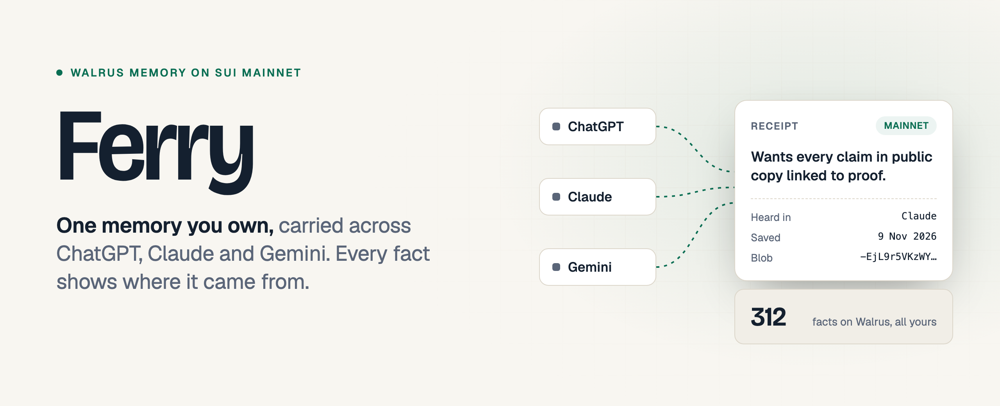
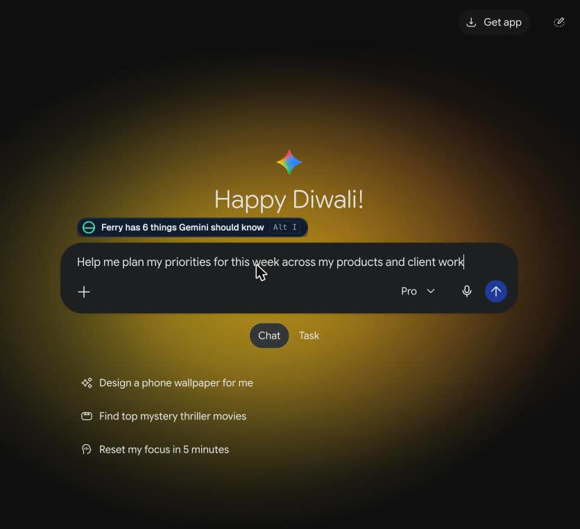
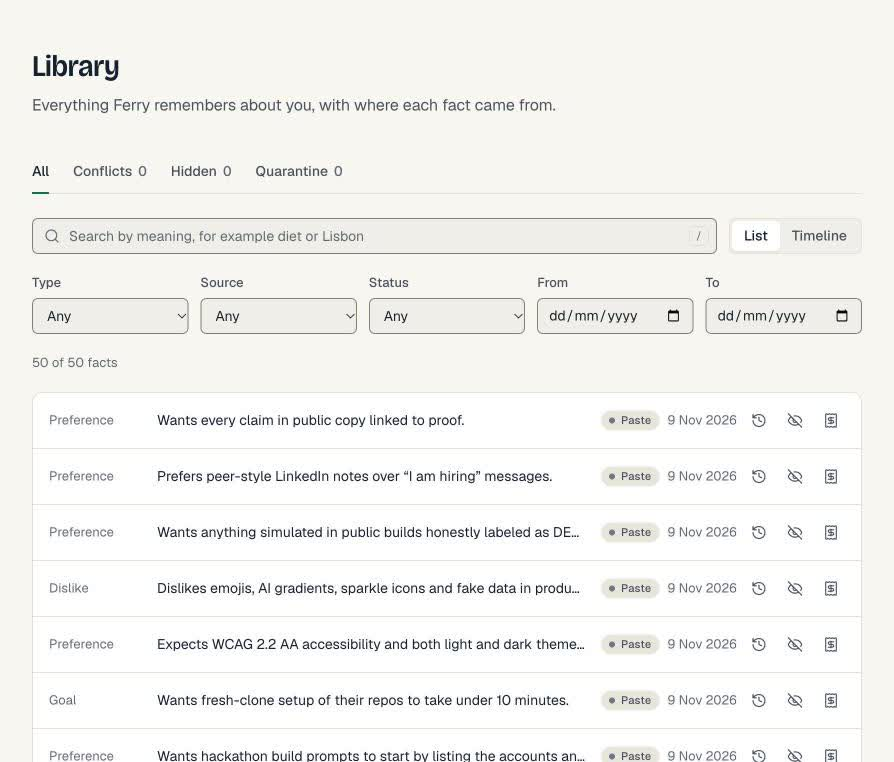
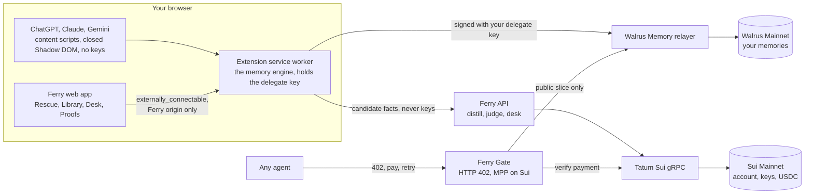

<picture>
  <source media="(prefers-color-scheme: dark)" srcset="docs/media/hero-dark.png">
  
</picture>

<p align="center">
  <a href="https://ferry-memory.vercel.app"><b>Open the app</b></a>
  &nbsp;&middot;&nbsp;
  <a href="https://github.com/Adwaitbytes/ferry/releases/tag/v0.1.0-beta.1"><b>Get the extension</b></a>
  &nbsp;&middot;&nbsp;
  <a href="https://dev.to/adwaitkeshari/ferry-one-ai-memory-you-own-carried-across-chatgpt-claude-and-gemini-on-walrus-3f67"><b>Read the write up</b></a>
  &nbsp;&middot;&nbsp;
  <a href="#mainnet-proof"><b>Check the proof</b></a>
</p>

<p align="center">
  <a href="https://github.com/Adwaitbytes/ferry/actions/workflows/ci.yml"></a>
  <a href="https://suiscan.xyz/mainnet/object/0x2707ca76b9a7ed62b1405089b745738e64f6d83e61763668d9c26c7572c691d2"></a>
  <a href="docs/REDTEAM.md"></a>
  
  <a href="LICENSE"></a>
</p>

---

You tell ChatGPT about your work. You tell Claude how you like answers written. You tell Gemini what you are building this week. Each one keeps a private profile of you, none of them talks to the others, and you own none of it. Switch apps and you start from zero.

**Ferry gives you one memory that is yours.** It lives on Walrus Mainnet, it belongs to your Sui wallet, and it follows you into whichever AI you open next. Every fact carries a receipt: which AI heard it, when, and the blob on Walrus that holds it.

<p align="center">
  
</p>

## What it does

| | | Real result from my own use |
|---|---|---|
| **Rescue** | Drop a ChatGPT, Claude or Gemini export, or paste what an AI knows about you. Ferry parses it on your device, pulls out the facts you actually said, shows each with its quote, and writes the ones you approve to Walrus. | 312 facts from my Claude history, now on Mainnet |
| **Carry** | Start typing in another AI. A small chip offers the facts it should know. You click Insert. Nothing is ever added silently. | Gemini, which had never seen any of it, got 6 facts about my week |
| **Stays current** | When a new fact contradicts an old one, Ferry shows both with their sources. You pick, and the old one is superseded on Walrus with its history kept. | Covered end to end in tests |
| **Blackout Drill** | Chat in Ferry Desk, cut the model off mid thread, and the conversation carries on in another model from the same memory. | Claude cut off, Gemini answered from Walrus, 0 facts lost |
| **Share and Earn** | Publish one slice of your memory. An agent gets HTTP 402, pays 0.01 USDC on Sui, and receives only that slice. The money goes to your address. | [A real paid recall](https://suiscan.xyz/testnet/tx/BfqBDhWvz3gcy9Dys1mUPxjm4Tvisu6uLSnT2KQ1j4Gv) (Sui Testnet) |

<table>
  <tr>
    <td width="50%"></td>
    <td width="50%"></td>
  </tr>
  <tr>
    <td><sub>Live on gemini.google.com: Ferry offers what Gemini should know. You decide.</sub></td>
    <td><sub>The Library: every fact, where it came from, and a receipt one click away.</sub></td>
  </tr>
</table>

## Try it in two minutes

1. [Download the extension ZIP](https://github.com/Adwaitbytes/ferry/releases/tag/v0.1.0-beta.1), unzip it, open `chrome://extensions`, turn on Developer mode and click **Load unpacked**.
2. Open [ferry-memory.vercel.app](https://ferry-memory.vercel.app), connect a Sui wallet and pair the extension. Gas for pairing is sponsored, so an empty wallet works.
3. Go to **Rescue**, paste what one of your AIs knows about you, approve the facts, then open another AI and start typing.

## For agents: pay a person for their context

An agent asks for a Share Card and gets a real `402 Payment Required`, live right now:

```bash
curl -i "https://ferry-gate-testnet.vercel.app/v1/cards/iHPccX5_q18U2kO4UeHc4w/recall?q=how+do+they+work"
# HTTP/2 402
# WWW-Authenticate: Payment ...   (0.01 USDC on Sui, paid to the card owner)
```

With the SDK, paying and reading is one call. The SDK refuses to pay more than you allow and refuses any coin that is not USDC on the network you chose.

```ts
import { createFerry, explorerTxUrl } from '@ferry/sdk';

const ferry = createFerry({ baseUrl: 'https://ferry-gate-testnet.vercel.app', network: 'testnet' });
const { results, payment } = await ferry.card('iHPccX5_q18U2kO4UeHc4w').recall('how do they work', { payer });

for (const fact of results) console.log(fact.text, fact.sources, fact.heardAt);
console.log(explorerTxUrl(ferry.network, payment.digest));
```

A full working agent lives in [examples/tripscout](examples/tripscout/index.ts).

## How it works



**Why the extension is the engine.** The Walrus Memory relayer sends no CORS headers today ([walrus-memory#1119](https://github.com/MystenLabs/walrus-memory/issues/1119)), and putting your key on a Ferry server would make Ferry a custodian of your memory. So every memory request leaves from your own browser, signed by a key that never leaves the service worker. No Ferry server sees memory traffic. Every data flow is in [docs/ARCHITECTURE.md](docs/ARCHITECTURE.md).

**How receipts work on a store with no tags.** Each memory ends with a compact header holding its type, sources, a hashed conversation id, date, confidence, quote hash, supersede link and status ([header.ts](packages/core/src/header.ts)). Receipts, conflicts and forget are all built on that header. A fact that tries to include header brackets is refused, so no one can forge one.

## Built on Walrus, Seal, Sui and Tatum

| | What Ferry does with it | Code |
|---|---|---|
| **Walrus Memory** | Bulk writes through a paced queue that respects the real relayer limits; recall merged with recency and re-ranked locally; a new laptop rebuilds its index from Walrus | [governor.ts](packages/memwal/src/governor.ts), [import-queue.ts](packages/memwal/src/import-queue.ts), [rank.ts](packages/memwal/src/rank.ts), [local-index.ts](packages/memwal/src/local-index.ts) |
| **Walrus blobs** | The receipt drawer reads each blob's certified and end epoch; Verify refetches the bytes from the aggregator and checks them | [readers.ts](packages/chain/src/readers.ts), [verify.tsx](packages/ui/src/components/verify.tsx) |
| **Seal** | Vault mode encrypts each fact in the browser before it leaves, and encrypted export backups reuse the MemWal policy | [vault.ts](packages/memwal/src/vault.ts), [backup.ts](apps/web/src/lib/backup.ts) |
| **Sui** | Pairing adds a delegate key with sponsored gas; Devices removes one; Gate payments are USDC to the owner's own address | [tx/index.ts](packages/chain/src/tx/index.ts), [tx/sponsor.ts](packages/chain/src/tx/sponsor.ts), [gateway.ts](packages/pay/src/gateway.ts) |
| **Tatum** | Every chain read goes through Tatum's native Sui gRPC: accounts and delegate keys, blob epochs, payment checks (status, coin, amount, recipient, finality), USD prices, behind a 3 rps token bucket with a credit meter | [tatum.ts](packages/chain/src/tatum.ts), [payment.ts](packages/chain/src/payment.ts), [price.ts](packages/chain/src/price.ts), [limiter.ts](packages/chain/src/limiter.ts) |
| **MPP and x402** | Gate speaks MPP on Sui USDC with an x402 fallback; every payment digest is stored under a unique constraint so it can be used once | [packages/pay](packages/pay/src) |

Using Claude Code? Set `MEMWAL_NAMESPACE=ferry-core` in the official Walrus Memory MCP config and it reads the same memory.

## Mainnet proof

Every value below can be checked on an explorer.

| What | Proof |
|---|---|
| My memory account, 312 memories, 0 failed writes | [`0x2707ca76...c691d2`](https://suiscan.xyz/mainnet/object/0x2707ca76b9a7ed62b1405089b745738e64f6d83e61763668d9c26c7572c691d2) |
| Three memory blobs, spot check | [blob 1](https://aggregator.walrus-mainnet.walrus.space/v1/blobs/-EjL9r5VKzWYjKL96vAVrqgAcI7GO5e57n9CgRYggQk), [blob 2](https://aggregator.walrus-mainnet.walrus.space/v1/blobs/QTVvQp8j9mwefd2jjF34Yo1uNYUWy0BuTE_mfeiPHzk), [blob 3](https://aggregator.walrus-mainnet.walrus.space/v1/blobs/IUjeWHo7EK3npKAYCcny9H7_UtiWrKpoW1nIrfN98Lg) |
| Owner wallet | [`0x3b1d6cbb...a9d376`](https://suiscan.xyz/mainnet/account/0x3b1d6cbb38e58113e91642954a84998224fb6b2db0f18495905eb2afb0a9d376) |
| This browser's delegate key (`MEMWAL_AGENT_ID`) | `aa0e1b0af8be8765d65d86876ca7034259fced902035d29c2420cdca5354e2ff`, listed on the account object |
| Public profile account used by Gate | [object](https://suiscan.xyz/mainnet/object/0x3a75eca8c67b7f70a7a2de8cdc7d8fb85137e3231c6023fc555e37e3ec4cfe8f), [create tx](https://suiscan.xyz/mainnet/tx/Hih5RG5uqiyZ85dEDaHqKTAKVrpTCNPTJx9pKBNDJQjs), [delegate key tx](https://suiscan.xyz/mainnet/tx/2Ra4iESUsJwdQBMdbqtfN3ue4r2dZv7j9ryfyejLtfZY) |
| Paid recall, 0.01 USDC agent to owner | [`BfqBDhWv...Q1j4Gv`](https://suiscan.xyz/testnet/tx/BfqBDhWvz3gcy9Dys1mUPxjm4Tvisu6uLSnT2KQ1j4Gv) on Sui Testnet, see [limitations](#limitations-stated-plainly) |
| Live services | [web app](https://ferry-memory.vercel.app), [Gate, Mainnet](https://ferry-gate.vercel.app/health), [Gate, Testnet](https://ferry-gate-testnet.vercel.app/health), [proofs page](https://ferry-memory.vercel.app/proofs) |

## How Ferry learned over time

Real numbers from my own use during the build, read on 9 Nov 2026. Zeros are left as zeros.

| Signal | Count | What it changed |
|---|---|---|
| Facts rescued | **312** from my Claude history: 128 project, 67 preference, 39 decision, 15 person, 14 dislike, 13 identity, 13 skill, 9 goal, 9 routine, 4 constraint, 1 lesson. 3 doubtful facts discarded in review. | The chip had something useful to offer on the very first chat |
| Cross app insertions | **1** verified: 6 facts offered and inserted in Gemini | Context told to one AI was used by another |
| Blackout Drill | Claude cut off, Gemini answered *"Based on your product priorities, you should focus on Select 360 first this week."* | It had never been told that. The fact came from Walrus, with its receipt |
| Paid recalls | **1**, 0.01 USDC | An agent paid me for a slice of my context |
| Live captures, merges, conflicts | 0 so far | Live capture on Claude was fixed on 9 Nov; conflicts are covered by e2e tests |

## Security

Ferry stores the most personal data an AI has about you, so it is built to assume every page and every input is hostile. Full model in [docs/THREAT_MODEL.md](docs/THREAT_MODEL.md), disclosure policy in [SECURITY.md](SECURITY.md).

- **Keys stay in the service worker.** Chat pages never see them. The chip renders in a closed Shadow DOM using text nodes only.
- **The sender decides, not the payload.** A chat page cannot wipe, hide or change settings, whatever it sends ([senders.ts](apps/extension/src/worker/senders.ts)).
- **Only your own words, only with your approval.** Every candidate fact passes an injection scanner (instructions aimed at AIs, exfiltration links, encoded payloads, hidden Unicode) and a sensitive data filter. Card numbers, government ids and secrets are always blocked.
- **Inserted context is labelled as facts, not instructions.**
- **Payments cannot be replayed.** Gate verifies every payment through Tatum and records its digest once.
- **No secrets in bundles.** API keys live only in server env, request bodies are never logged, and CI fails if a key pattern shows up in a build.

**81 of 81 red team cases blocked**, run on every push by `pnpm redteam`:

| Poisoning | Prompt injection | Unicode smuggling | XSS | Header forgery | Forged messages | Payments | Enumeration | Zip bombs | Sensitive data | Hygiene |
|:-:|:-:|:-:|:-:|:-:|:-:|:-:|:-:|:-:|:-:|:-:|
| 5/5 | 8/8 | 8/8 | 5/5 | 5/5 | 8/8 | 13/13 | 3/3 | 7/7 | 14/14 | 5/5 |

## Limitations, stated plainly

- **The live paid recall ran on Sui Testnet.** I had no real money for Mainnet USDC, so the payment used faucet USDC through a second Gate. The code is identical; `GATE_SUI_NETWORK` picks the network, and the [Mainnet Gate](https://ferry-gate.vercel.app/health) is live and answers 402 in Mainnet USDC. Memory is on Walrus Mainnet either way.
- **Standard mode is not end to end encrypted.** The hosted relayer encrypts and stores your facts but sees the text while processing it. Vault mode encrypts in your browser so the relayer never sees the text; it still sees encrypted vectors, your address, the namespace and when you search.
- **Forget means hidden, not deleted.** Walrus has no delete. Ferry writes a tombstone and never inserts the fact again, but the encrypted blob stays until its storage epoch ends, and the receipt shows that date.
- **Delegate keys are account wide.** Any paired key can read the whole account, which is why Gate uses a separate Public profile account. Each account allows at most 20 keys.
- **The extension is required for memory.** Without it, the web app shows proofs and docs only.
- **Limits are real.** The relayer allows 30 points per minute per key, so a large import is paced and can take minutes; the UI says "cooling down" instead of failing. Tatum's free plan allows 3 requests per second.
- **Export formats change without notice.** ChatGPT saved memories are not in the ChatGPT export, so Ferry reads them from your own settings page when you click Rescue there.

## Run it locally

Node 22.12+, pnpm 12, Chrome 116+. Fresh clone to running in under ten minutes.

```bash
git clone https://github.com/Adwaitbytes/ferry.git && cd ferry
pnpm install
cp .env.example .env.local     # every variable is documented inside
pnpm dev                       # web app on :3000 and Gate
pnpm --filter ./apps/extension build
```

Load `apps/extension/.output/chrome-mv3` as an unpacked extension, open http://localhost:3000 and pair.

<details>
<summary><b>Environment variables</b></summary>

| Variable | Needed for |
|---|---|
| `TATUM_API_KEY` | Chain reads, payment checks, prices. Optional: without it Ferry uses Tatum's anonymous plan |
| `TATUM_SUI_GRPC_URL` | Tatum Sui gRPC endpoint, prefilled |
| `MEMWAL_RELAYER_URL`, `MEMWAL_PACKAGE_ID`, `MEMWAL_REGISTRY_ID` | Walrus Memory Mainnet, prefilled |
| `ANTHROPIC_API_KEY`, `OPENAI_API_KEY`, `GOOGLE_GENERATIVE_AI_API_KEY`, `OPENROUTER_API_KEY` | Distill and Desk |
| `DATABASE_URL` | Neon Postgres for Gate cards and the payment replay table |
| `GATE_PUBLIC_ACCOUNT_ID`, `GATE_DELEGATE_PRIVATE_KEY`, `GATE_SUI_NETWORK` | Gate only |
| `SESSION_SECRET` | Wallet login sessions |
| `NEXT_PUBLIC_FERRY_WEB_ORIGIN` | The one origin allowed to talk to the extension |

</details>

Every check CI runs:

```bash
pnpm typecheck && pnpm lint && pnpm test && pnpm redteam && pnpm copycheck && pnpm e2e
```

## Repo map

```
apps/
  extension    Chrome MV3: service worker memory engine, chat site chip, side panel
  web          Next.js app and API: Rescue, Library, Desk, Devices, Proofs
  gate         Paid recall API: HTTP 402, MPP on Sui
packages/
  core         Schemas, header codec, message contracts
  memwal       Walrus Memory engine, rate governor, import queue, Vault mode
  chain        Tatum Sui gRPC client, readers, tx builders, payment checks
  pay          MPP and x402 on Sui, replay store, paying client
  sdk          @ferry/sdk for agents
  distill      Fact extraction, injection and sensitive data scanners
  importers    ChatGPT, Claude, Gemini and paste parsers
  adapters     Site adapters for chatgpt.com, claude.ai, gemini.google.com
  ai, ui       Model wiring and the design system
examples/
  tripscout    An agent that buys a Share Card
```

Deeper reading: [architecture](docs/ARCHITECTURE.md), [design system](docs/DESIGN.md), [decisions](docs/DECISIONS.md), [threat model](docs/THREAT_MODEL.md), [red team](docs/REDTEAM.md).

---

<p align="center">
  Built by <a href="https://github.com/Adwaitbytes">Adwait Keshari</a> for Total Recall, the Tatum x Walrus hackathon.<br>
  <a href="LICENSE">MIT licensed</a>. <b>Switch AIs. Keep yourself.</b>
</p>
