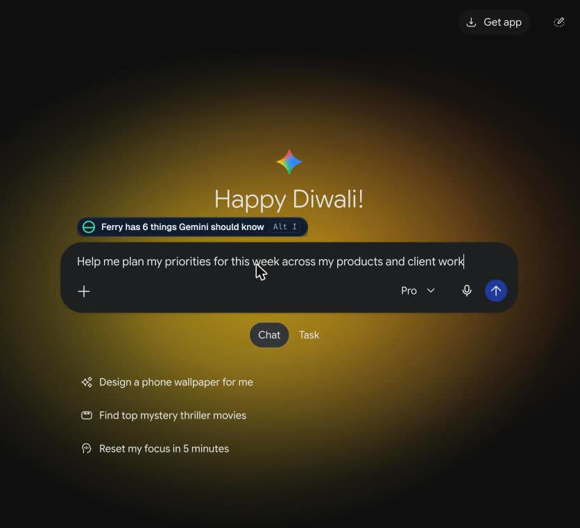
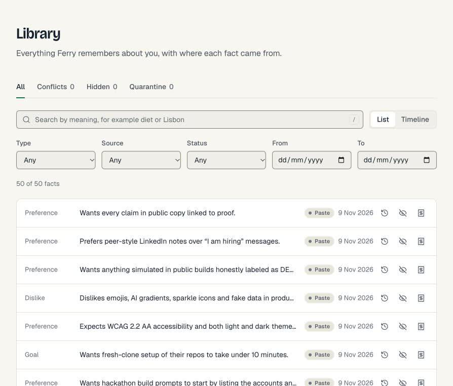
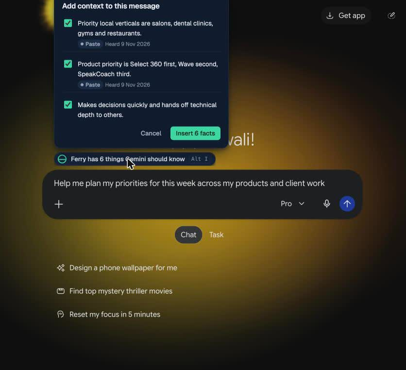

I use ChatGPT, Claude and Gemini every week. Each of them knows things about me: what I'm building, which stack I reach for, how I like answers written. None of them knows what the others know, and I don't own any of it. When I switch, I start over.

Ferry is my fix. It takes the memory those apps hold about you, moves it into a store you own on Walrus Mainnet, and brings it back into whichever AI you open next. Every fact carries a receipt that shows where it came from. I built it in about 36 hours for Total Recall, the Tatum x Walrus hackathon.

- Repo: https://github.com/Adwaitbytes/ferry
- Live app: https://ferry-memory.vercel.app
- Demo video: {{FILL: video URL}}



## Why now

Walrus has been making this argument all week. Their Nov 5 article asked who actually owns the AI memory everyone shipped in October, and argued that memory you can't take with you is just storage rented from one vendor ([Walrus](https://blog.walrus.xyz/memwal-long-term-memory-for-ai-agents/)). On Nov 8 they posted that a good assistant remembers what you said and a great one shows where it heard it ([Walrus](https://blog.walrus.xyz/memwal-long-term-memory-for-ai-agents/)). On Nov 4, that agents need context that stays current, not outdated decisions ([Walrus](https://blog.walrus.xyz/memwal-long-term-memory-for-ai-agents/)).

We read those as a spec. Portable, with receipts, and current.

## What Ferry does

**Rescue.** Drop your ChatGPT, Claude or Gemini export into the web app. The ZIP is parsed on your device in a Web Worker and never uploaded. Ferry keeps only what you typed, asks a model to pull out durable facts, and shows each one next to the exact quote it came from. You approve, edit or discard. Approved facts go to Walrus Memory. On my own export that was 312 facts.



**Carry.** A Chrome extension watches the chat composer on chatgpt.com, claude.ai and gemini.google.com. When you tell one AI something durable, a small toast offers to save it. When you start typing in another AI, Ferry recalls what's relevant and shows a chip: "Ferry has 2 things Claude should know". You click Insert, and a clearly marked block goes at the top of your prompt. Ferry never inserts anything on its own.



**Stays current.** When a new fact contradicts an old one, Ferry shows both side by side with their sources. Pick one, and Ferry writes the new fact to Walrus with a pointer to the old blob it supersedes. The old one stays in history and is never inserted again.

**Blackout Drill.** Ferry Desk is a small chat with a model picker. Press Cut off, and the current provider goes dark. That part is simulated and labelled DEMO. The thread continues on another model, recalls the same memory from Walrus, and the counter says "0 facts lost". Your memory never lived with the provider, so there was nothing to lose.

**Share and Earn.** You can publish a slice of your memory, say "food preferences", as a Share Card with a price. An agent that wants it calls Ferry Gate, gets HTTP 402, pays 0.01 USDC on Sui to your address, and gets only that slice.

## How Ferry uses Walrus

Walrus Memory is the store. Every fact is a memory in your own MemWalAccount on Sui Mainnet, written through the hosted relayer with a delegate key that lives in the extension.

Walrus Memory stores plain text with no tags, so we append one header line to every memory:

```
I am allergic to cashews.
⟦ferry:v1 t=constraint s=chatgpt c=<hash> at=<date> cf=0.92 q=<hash> sup=- st=active⟧
```

The sentence comes first so embeddings stay clean. The header carries the fact type, which AIs it was heard in, a hashed conversation id, the date, confidence, a hash of the supporting quote, the blob it supersedes and its status. That one line is what makes receipts, conflicts and forget possible on a store that doesn't have them built in. A fact containing the header brackets is refused before it's written, so nobody can forge one ([header.ts](https://github.com/Adwaitbytes/ferry/blob/main/packages/core/src/header.ts)).

A few things we learned the hard way, all from reading the relayer source:

- The rate limit is points, not calls. A single `remember` costs 5 points; `rememberBulk` with up to 20 items costs 10. A key gets 30 points a minute and an account 500 an hour. So every write in Ferry is a bulk write through a paced queue ([governor.ts](https://github.com/Adwaitbytes/ferry/blob/main/packages/memwal/src/governor.ts)).
- The relayer doesn't send CORS headers yet ([#1119](https://github.com/MystenLabs/walrus-memory/issues/1119)). We didn't want a Ferry server in the memory path, so the extension service worker became the memory engine for everything, including the web app, which talks to it through `externally_connectable`.
- There is no delete. Forget in Ferry means a tombstone memory plus local exclusion, and the receipt drawer shows the storage epoch when the encrypted blob actually expires. We say exactly that in the UI.

**Seal** is used in Vault mode. Instead of the relayer embedding and encrypting your text, the browser makes the embedding and Seal-encrypts the fact before it leaves the device ([vault.ts](https://github.com/Adwaitbytes/ferry/blob/main/packages/memwal/src/vault.ts)). The relayer still sees vectors, the owner address and when you search, and we say so.

**Walrus blobs** back the receipts. The Verify button on any fact refetches its blob from the Walrus aggregator and checks the bytes against the blob id. Since the blob is ciphertext, the UI words it carefully: the ciphertext on Walrus matches the blob id.

## How we used Tatum

Sui's public JSON-RPC was deprecated during the hackathon, so every chain read in Ferry goes through Tatum's Sui gRPC gateway at `sui-mainnet-grpc.gateway.tatum.io`. One catch: Tatum speaks native gRPC, not gRPC-Web, so the default browser client fails against it. We run a native transport on the server and put a thin proxy in front of it, which also keeps the API key out of the extension bundle ([tatum.ts](https://github.com/Adwaitbytes/ferry/blob/main/packages/chain/src/tatum.ts)).

Tatum does four real jobs in Ferry:

1. **Account and delegate reads.** Pairing confirms your new delegate key is on your MemWalAccount by reading the object through Tatum. The Devices page lists every key with its label and date.
2. **Blob epochs.** Each receipt shows the Walrus Blob object's certified epoch, end epoch and owner, read live ([readers.ts](https://github.com/Adwaitbytes/ferry/blob/main/packages/chain/src/readers.ts)).
3. **Payment verification.** When an agent pays Gate, we fetch the transaction through Tatum and check status, coin type, amount, recipient and finality before serving anything ([payment.ts](https://github.com/Adwaitbytes/ferry/blob/main/packages/chain/src/payment.ts)).
4. **Price data.** Earnings show in USDC and in dollars using Tatum's exchange rate endpoint, cached for 60 seconds ([price.ts](https://github.com/Adwaitbytes/ferry/blob/main/packages/chain/src/price.ts)).

The free plan allows 3 requests per second, so the proxy has a token bucket, a short cache and a credit meter you can see on the Proofs page. We used 20 of 100,000 free-plan credits by 9 Nov 2026 credits over the hackathon.

## Agent payments with MPP on Sui

Gate speaks MPP, the Machine Payments Protocol, using `@suimpp/mpp` on Sui Mainnet with Circle USDC. The flow is plain HTTP:

1. The agent asks for a card and gets `402` with a `WWW-Authenticate: Payment` challenge naming the price and recipient.
2. It sends 0.01 USDC to the card owner's address and retries with the digest.
3. Gate re-verifies the transaction through Tatum, inserts the digest into a Neon table with a unique constraint so it can never be replayed, and returns the facts with a payment receipt.

Ferry never holds the money. And because Walrus delegate keys can read a whole account, Gate never gets a key to your private memory. It reads from a separate Public profile account that only contains what you published ([gateway.ts](https://github.com/Adwaitbytes/ferry/blob/main/packages/pay/src/gateway.ts)).

Our test agent, TripScout, pays from a terminal in about 13 lines. The first real payment ran on Sui Testnet, because we had no real money for Mainnet USDC: TripScout paid 0.01 USDC straight to the card owner, the Gate checked it through Tatum, and five facts came back ([transaction](https://suiscan.xyz/testnet/tx/BfqBDhWvz3gcy9Dys1mUPxjm4Tvisu6uLSnT2KQ1j4Gv)). The same code runs on Mainnet; only one setting changes.

The payment on Suiscan: https://suiscan.xyz/testnet/tx/BfqBDhWvz3gcy9Dys1mUPxjm4Tvisu6uLSnT2KQ1j4Gv

## How Ferry learned over time

The point of a memory is that the product behaves differently tomorrow because of what happened today. Here is what that looked like on 9 Nov 2026, using the founder's own real data. Every number below is read from the paired extension's index and from Walrus.

- **312 facts rescued** from the founder's own Claude history and written to Walrus Mainnet, 0 failed writes. We asked Claude what it knew, then four more times to search older chats. Each answer went through Rescue, where Ferry pulled out facts and we reviewed every card. Three were thrown out: two near duplicates and one that read a client's factory as the founder's own.
- **What they cover:** 128 projects, 67 preferences, 39 decisions, 15 people, 14 dislikes, 13 identity facts, 13 skills, 9 goals, 9 routines, 4 constraints and 1 lesson.
- **The import taught the product.** The first try turned 91 lines into 19 facts and then failed outright on a long chunk. We changed how pasted answers are split, gave each chunk a fair output budget, and made a failed batch split itself and retry instead of failing the import. After that, 80 to 100 lines of real history became 40 to 75 clean facts per pass.
- **Memory showed up somewhere else.** Typing a planning question into Gemini, a model that never saw any of this, Ferry offered "6 things Gemini should know", including "Product priority is Select 360 first, Wave second, SpeakCoach third", with the receipt one click away.
- **It survived a provider cut.** In the Blackout Drill we cut Claude off mid-thread. The same thread continued on Gemini, which answered from the same Walrus memory: "focus on Select 360 first this week." Facts lost: 0.

Total memories on Mainnet: 312. Account: https://suiscan.xyz/mainnet/object/0x2707ca76b9a7ed62b1405089b745738e64f6d83e61763668d9c26c7572c691d2.

## Security, briefly

Ferry stores things people say about themselves, and it writes them somewhere they can't be deleted. So we treated poisoning as the main threat. Ferry only saves the user's own messages, only with approval, and every candidate passes an injection scanner (imperatives aimed at AIs, exfiltration URLs, encoded payloads, hidden Unicode) and a sensitive data detector before anything is written. Card numbers, government ids and secrets are always blocked. The red-team suite has 81 cases; all 81 pass in CI. Details in [THREAT_MODEL.md](https://github.com/Adwaitbytes/ferry/blob/main/docs/THREAT_MODEL.md) and [REDTEAM.md](https://github.com/Adwaitbytes/ferry/blob/main/docs/REDTEAM.md).

## What's honest to say

Standard mode is not end to end encrypted, because the hosted relayer sees text while it processes it. Vault mode fixes that at the cost of one wallet approval per session. Forget is hide, not delete. The extension is required for memory operations until the relayer ships CORS. And export formats change without notice, so our parsers are defensive and we will keep testing them against fresh exports.

## Try it

- Web app: https://ferry-memory.vercel.app
- Extension: https://github.com/Adwaitbytes/ferry/releases/tag/v0.1.0-beta.1 (load unpacked in Chrome)
- Repo, with a 10 minute quickstart: https://github.com/Adwaitbytes/ferry

Switch AIs. Keep yourself.

Built by Adwait Keshari for Total Recall by [Tatum](https://tatum.io) x [Walrus](https://walrus.xyz).
